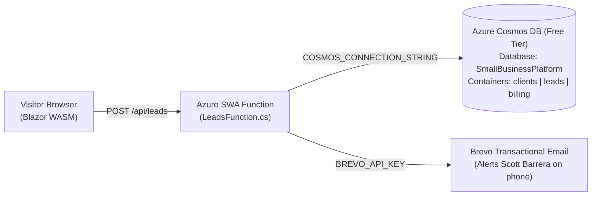

# Premier Poured Walls LLC Website

A high-performance, configuration-driven **$0/month small business website, lead capture, and customer inquiry platform** for **Premier Poured Walls LLC** built with **Blazor WebAssembly (.NET 10)**, **Azure Static Web Apps Managed Functions (.NET 10)**, **Azure Cosmos DB (Multi-Tenant Free Tier)**, **Cloudflare Email Routing**, and **Brevo Transactional Email**.

---

## Business Profile

* **Company Name:** Premier Poured Walls LLC
* **Owner & Founder:** Scott Barrera
* **Phone:** (423) 457-2024
* **Email:** premierpouredwalls@gmail.com
* **Headquarters:** Cleveland, TN
* **Service Area:** Southeast Tennessee & North Georgia (Cleveland, Chattanooga, Lookout Mountain, Dunlap, Ocoee, Ducktown, Reliance, Rocky Face GA & surrounding communities)
* **Tagline & Mission:** *"Quality and Integrity in Every Pour"* • *"Let us pour a solid foundation under that forever home of your dreams."*
* **Core Services:**
  * Poured Concrete Basements & Foundations
  * Storm Shelters & "Fort Knox" Tornado Safe Rooms
  * Concrete Retaining Walls & Curved Radius Walls
  * Excavation & Laser-Guided Footing Digs
  * Commercial & Tall Wall Formwork (up to 16-foot pours)
  * Foundation Waterproofing & Cold-Joint Drainage Coordination
* **Brand Colors:**
  * Deep Industrial Navy / Midnight Steel: `#0f2b48`
  * Blueprint Electric Blue: `#0284c7`
  * Clean Foundation Slate: `#f1f5f9`
  * Off-White Surface: `#f8fafc`

---

## Architecture Overview

---

## Repository Structure

* `Client/` — .NET 10 Blazor WebAssembly PWA
  * `wwwroot/appsettings.json` — Complete brand configuration, color palette, services list, project gallery items, testimonials, and contact form settings
  * `wwwroot/images/logo.png` & `logo.jpg` — Official Premier Poured Walls concrete mixer truck & buildings logo
  * `wwwroot/images/banner.jpg` — Official Facebook cover header banner
  * `wwwroot/images/scotty-barrera.jpg` & `scotty-family.jpg` — Founder and family photography
  * `wwwroot/images/projects/` — 10 curated on-site work photos from real projects in Dunlap, Lookout Mountain, Rocky Face GA, Reliance Castle, Ocoee, Ducktown, and South Cleveland
  * `Models/SiteConfiguration.cs` — Strongly typed configuration models
  * `Layout/MainLayout.razor` — Dynamic CSS variable injection and responsive header/footer layout
  * `Pages/` — `Index.razor`, `About.razor`, `Services.razor`, and `Contact.razor`
* `Api/` — .NET 10 Isolated Azure Functions (Azure Static Web Apps Managed API)
  * `LeadsFunction.cs` — `POST /api/leads` endpoint with honeypot spam protection, native Cosmos DB REST storage, and Brevo email notifications
* `database/cosmos_schema.json` — Cosmos DB document schema
* `scripts/`
  * `sync-client-config.py` — Auto-generates `index.html`, `sitemap.xml`, `robots.txt`, and `manifest.webmanifest` from `appsettings.json`
  * `onboard-client.py` — Master CLI to onboard into Cosmos DB, configure Cloudflare DNS & Email Routing, and authenticate Brevo domain

---

## Agency Portal Integration

This repository follows the Agency Standard:
* **Client ID:** `premier-poured-walls`
* **Agency Portal:** [https://purple-flower-020acac0f.4.azurestaticapps.net](https://purple-flower-020acac0f.4.azurestaticapps.net)
* Centralized multi-tenant tracking across `clients`, `leads`, and `billing` containers in Azure Cosmos DB (`SmallBusinessPlatform`).
